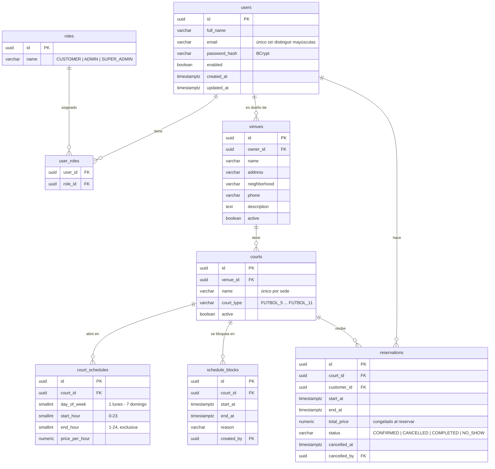

# Modelo de datos

PostgreSQL 16. El esquema lo crean **solo** las migraciones de Flyway en
`backend/src/main/resources/db/migration` (`V1__…` a `V5__…`). Hibernate únicamente *valida* que las entidades
coincidan (`ddl-auto: validate`), nunca modifica tablas.

## Restricciones importantes

| Restricción | Tabla | Qué garantiza |
| --- | --- | --- |
| `ex_reservations_no_overlap` (EXCLUDE + GiST) | reservations | Dos reservas no canceladas de la misma cancha nunca se cruzan, aunque lleguen al mismo tiempo. Ver [ADR 002](../decisiones/002-reservas-sin-solapamiento.md) |
| `ex_schedules_no_overlap` (EXCLUDE + GiST) | court_schedules | Las franjas de un mismo día no se solapan |
| `ux_users_email_lower` | users | Email único sin distinguir mayúsculas |
| `ux_courts_venue_name` | courts | Nombre de cancha único por sede |
| `ck_*` | varias | Rangos válidos (fin > inicio, horas 0-24, precios ≥ 0, estados y tipos permitidos) |

## Convenciones

- Llaves primarias `UUID` generadas por la aplicación (también hay `DEFAULT gen_random_uuid()` para inserts manuales).
- Todas las fechas son `TIMESTAMPTZ` en UTC. La conversión a hora de Colombia se hace en el backend (`BusinessTime`).
- Las sedes y canchas **no se borran**: se desactivan (`active = false`) para conservar el historial de reservas.
- Cada cambio al esquema va en una migración nueva (`V6__…`). Una migración que ya está en `develop` **no se edita**.
